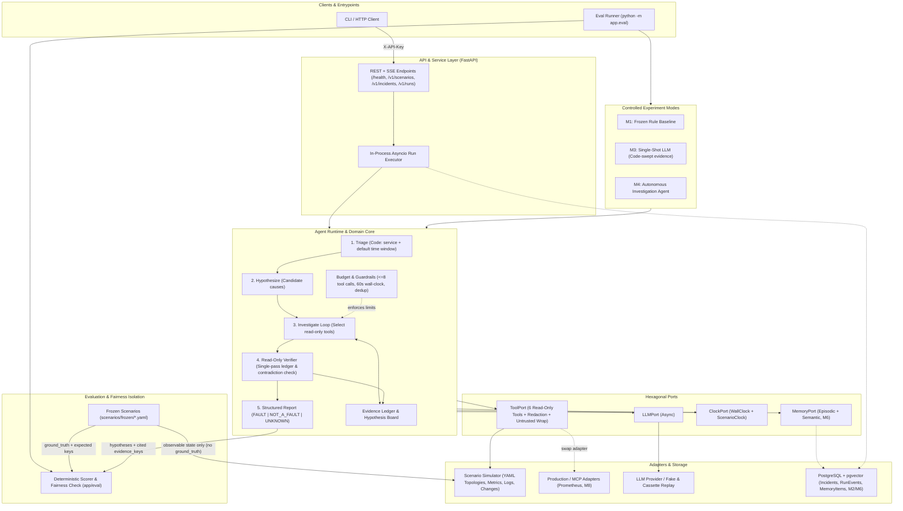

# AgentOps

Read-only incident diagnosis API. Milestone M0 is done: the FastAPI app, the FR-1 incident schema, one error response shape, and CI. Milestone M1 is done: the scenario simulator, the read-only tool port, the frozen scenario set, and the rule baseline. Milestone M3 is done: `LLMPort` (`OpenAIAdapter` and `FakeLLMAdapter`), `ThreadedToolPort`, the single-shot code-swept LLM harness with ledger citation checks, and the M3-vs-M1 comparison report. Milestone M4 is done: the hand-written investigation loop (`Triage -> Hypothesize & Investigate -> ReadOnlyVerifier -> DiagnosisReport`), `EvidenceLedger`, `HypothesisBoard`, cassette replay (`evals/cassettes/m4-frozen.json`), and SRE CLI inspection (`python -m app.eval inspect`). Persistence (M2) and CI eval gates (M5) are next.

## Architecture

AgentOps uses a **hexagonal (ports-and-adapters) architecture** where the diagnosis runtime depends only on abstract ports (`ToolPort`, `LLMPort`, `ClockPort`, `MemoryPort`). Every conclusion in the final report must cite stable `evidence_keys` recorded in the run's **Evidence Ledger**, and `ground_truth` is strictly isolated to the evaluation scorer.



### Read-Only Diagnostic Tools (`ToolPort`)

| Tool | Input Schema | Purpose | Production Counterpart |
| :--- | :--- | :--- | :--- |
| `query_metrics` | `MetricsQuery` (`service`, `time_range`, `metric`) | Time-series metrics (`cpu`, `memory`, `disk`, `latency_p99`, `error_rate`, `db_connections`) | Prometheus / Datadog |
| `search_logs` | `LogQuery` (`service`, `time_range`, `min_level`, `contains`, `offset`) | Paginated log search (max 20 lines/call, redacted & wrapped) | Grafana Loki / ELK |
| `get_service_status` | `ServiceQuery` (`service`, `time_range`) | Instance health and restart status | Kubernetes API |
| `get_recent_changes` | `ServiceQuery` (`service`, `time_range`) | Code deploys, rollbacks, and config flag changes in window | ArgoCD / GitHub Actions |
| `get_dependency_health` | `ServiceQuery` (`service`, `time_range`) | Downstream service topology and dependency health | Service Mesh / APM |
| `query_db_health` | `ServiceQuery` (`service`, `time_range`) | Connection pool usage, max connections, and queue depth | RDS / PgBouncer |

## Requirements

Python 3.12 or newer.

## Install

```bash
python3 -m venv .venv
source .venv/bin/activate
pip install -e ".[dev]"
```

## Run

```bash
uvicorn app.main:app --reload
```

- Health: <http://127.0.0.1:8000/health>
- API docs: <http://127.0.0.1:8000/docs>

The application entrypoint is `app.main:app`.

## Test

```bash
ruff check app tests
ruff format --check app tests
pytest
```

## Evaluate

The M1 rule baseline calls the tool port only. It does not read `ground_truth`. Frozen scenarios live in `scenarios/frozen/`. The committed score is `evals/baselines/m1-rule.json`, locked to `evals/baselines/frozen-manifest.json`.

The set has 29 scenarios. Nine are holdouts (`holdout: true`) for later prompt work. Beside the original single-service cases, the set includes:

- multi-hop faults, where the decisive evidence is on a downstream service
- drill-down faults, where the decisive evidence needs another service argument or a log window narrower than the default 20-line page
- one conflicting deploy-versus-config fault, where one sweep shows both signals
- one noisy `NOT_A_FAULT` case, where a pool phrase appears in a log and the host stays healthy

Sweeping every tool on the incident service, with the default window, does not return the decisive keys for the multi-hop and drill-down cases. Committed rule-baseline Top-1 is below 0.87, so M3 and M4 have room to move it. The number is in the baseline file.

Evidence precision is omitted from the average when the expected key set is empty and the report cites nothing. That is a correct `NOT_A_FAULT` or `UNKNOWN` abstention. Precision is 0 when keys were expected and the report cites nothing, and 0 when the report cites keys that were not expected.

The rule baseline and the original 23 scenarios landed in one commit (`f1eba32`). Git history does not show that the rules were frozen before those answers were written. The rules are generic thresholds. `RULE_ORDER` was not rearranged to recover the red-herring misses, and it was not rearranged when the later scenarios were added. Those later scenarios were written against the rules already in the tree.

```bash
python -m app.eval check
python -m app.eval write
python -m app.eval replay
python -m app.eval inspect drilldown-truncated-dns --mode m4
python -m app.eval run-m3 --provider fake
python -m app.eval run-m4 --provider fake
python -m app.eval compare evals/baselines/m3-single-shot.json evals/baselines/m4-agent.json
```

`check` fails when a fresh run does not match the committed M1/M3/M4 baseline files (`evals/baselines/m1-rule.json`, `evals/baselines/m3-single-shot.json`, `evals/baselines/m3-vs-m1.json`, `evals/baselines/m4-agent.json`, `evals/baselines/m4-vs-m3.json`), the scenario hashes (`evals/baselines/frozen-manifest.json`), or the M4 cassette replay (`evals/cassettes/m4-frozen.json`). To run M3 or M4 against a live OpenAI model, set `OPENAI_API_KEY` (and optional `OPENAI_MODEL` / `OPENAI_BASE_URL`) and pass `--provider openai`.

## Scenarios API

`GET /v1/scenarios` returns id, title, service, and tags. It does not return `ground_truth`. Send the shared key in `X-API-Key`. `/health` stays open.

```bash
export API_KEY=dev-key
uvicorn app.main:app --reload
curl -H "X-API-Key: $API_KEY" http://127.0.0.1:8000/v1/scenarios
```
