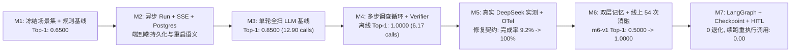

# 从 M1 到 M7：我们如何把 AgentOps 做成可验算、可回归、带真实模型消融的故障诊断系统

在动手写第一行 Agent 循环之前，我曾写过一篇笔记探讨一个问题：**什么样的故障诊断才算合格？**

如果系统报警，Agent 查了几条日志，最后输出一段通顺的话：“可能是数据库连接池出了问题，建议扩容连接池”——这在演示 Demo 里看起来很像回事，但在真实值班（On-Call）场景下几乎无法接手：

1. **它到底查了哪些服务、哪个时间窗？**
2. **结论里的每一句话，能否回到工具真实返回的证据键（`evidence_key`），还是模型顺手编造的？**
3. **当表面症状（比如上游超时或 CPU 飙升）和下游根因同时出现时，它有没有做交叉验证排除“红鲱鱼”？**
4. **当历史故障记忆与当前实时监控冲突时，它会盲信历史记忆，还是用当前证据推翻旧经验？**

为了把这些问题从“设计想法”变成可量化的工程结论，我们没有一上来就堆砌复杂的图编排框架和向量数据库，而是严格按照 **M1 $\rightarrow$ M2 $\rightarrow$ M3 $\rightarrow$ M4 $\rightarrow$ M5 $\rightarrow$ M6 $\rightarrow$ M7** 的顺序推进。每一个里程碑只引入一个核心变量，并用固定场景集、确定性回放（Cassette Replay）和真实模型（`deepseek-flash`，`k=3` 重复实验）做受控对照（Controlled Ablation）。

这篇文章完整记录从 **M1 到 M7** 的开发演进流程、中途踩到的真实工程坑（包括首次线上实测 79/87 失败的复盘与修复），以及全套量化实验结果。

---

## 一、核心工程量化总览（M0–M7）

在展开每个里程碑细节之前，先给出截至 **M7** 的工程交付与评测全景。文中所有数字均直接来自仓库提交的基线文件（[`evals/baselines/`](../evals/baselines/)）与不可变真实模型实测归档（[`evals/measurements/`](../evals/measurements/)），**离线确定性 Harness 基线（`offline-harness`）与真实 `deepseek-flash` 线上测量严格分表陈述，绝不混用**。

| 维度 | 量化结果 | 对应工程载体与验证方式 |
| :--- | :--- | :--- |
| **已完成里程碑** | **8 / 10（`M0`–`M7`）** | `M0` 底座、`M1` 模拟器与规则基线、`M2` 异步 API/SSE/Postgres、`M3` 单轮全扫 LLM、`M4` 多步调查循环、`M5` CI 门禁与实测、`M6` 双层记忆与消融、`M7` LangGraph/Checkpoint/HITL |
| **自动化测试套件** | **123 passed（`0` 失败）** | `pytest`（覆盖 SQLite 单元/集成测试 + 真实 PostgreSQL 16 与 Alembic 三版本迁移 `0001_m2 -> 0002_m6 -> 0003_m7` 进程重启验收） |
| **版本化评测场景集** | **35 个场景**（`29` `frozen-v1` + `6` `m6-v1`） | SHA-256 锁定于 [`frozen-manifest.json`](../evals/baselines/frozen-manifest.json)（其中 `9` 个 `holdout: true` 场景全程物理隔离）与 [`m6-manifest.json`](../evals/baselines/m6-manifest.json) |
| **Cassette 确定性回放** | **29 / 29 场景零漂移** | [`evals/cassettes/m4-frozen.json`](../evals/cassettes/m4-frozen.json)，每次 PR CI 自动运行 `python -m app.eval check` 校验 |
| **证据引用合规率** | **`0.0000` 最终采纳非法引用率** | 在全部离线基线（`M3`/`M4`/`M6`/`M7`）及全部 **`165` 次真实 `deepseek-flash` 运行**中，`accepted_illegal_citation_rate` 均为 `0.0000` |

---

## 二、M1 到 M7 的开发演进流程与工程思路

### 1. M1：先立靶子——场景模拟器、只读工具端口与纯规则基线

- **为什么要先做 M1？**
  很多 Agent 项目没有非 LLM 基线，导致写了几千行 Prompt 后，根本不知道这题是不是几个 `if/else` 阈值规则就能拿到 85% 分数。
- **我们做了什么**：
  1. **六边形只读工具端口（[`app/tools/port.py`](../app/tools/port.py)）**：定义 6 个严格只读工具（`query_metrics`、`search_logs`、`get_service_status`、`get_recent_changes`、`get_dependency_health`、`query_db_health`）。所有日志输出经过 [`app/tools/safety.py`](../app/tools/safety.py) 自动脱敏（剥离密钥、Token、邮箱，将内网 IP 映射为一致的 `<ip-1>` 伪名）并包裹在 `<untrusted_data>` 标签中，防止日志注入（Prompt Injection）。
  2. **29 个冻结评测场景（`scenarios/frozen/*.yaml`）**：覆盖 8 类根因与 3 类结论（`FAULT`、`NOT_A_FAULT`、`UNKNOWN`）。为了考验真正的多步推理，场景集中专门设计了：
     - **红鲱鱼干扰场景**（如 `cpu-with-disk-herring`、`db-pool-with-cpu-herring`）：次要指标越界，但日志证据指向另一根因；
     - **跨服务多跳场景**（如 `multihop-checkout-payments-pool`、`multihop-checkout-pricing-dns`）：告警在入口 `checkout`，但根因在下游一跳或二跳依赖；
     - **窄窗下钻场景**（如 `drilldown-truncated-dns`）：默认 20 行日志分页被常规错误填满，必须根据指标尖峰缩小时间窗才能翻出关键的 DNS `NXDOMAIN` 日志；
     - **9 个 Holdout 场景（`holdout: true`）**：从立项起立下规矩，**绝不读取这 9 个场景来调整规则或 Prompt**，防止面向测试集过拟合。
  3. **公平性硬隔离（[`app/eval/fairness.py`](../app/eval/fairness.py)）**：AST 静态检查确保任何诊断代码一旦导入或访问 `ground_truth` 直接报错阻断 CI。
- **M1 暴露出的边界**：纯规则基线 [`diagnose_with_rules()`](../app/eval/baseline.py) 在 29 个场景上拿到 **`Top-1 = 0.6500`、`Top-3 = 0.8000`**。固定优先级的规则无法处理红鲱鱼信号冲突，也无法跨服务自主下钻。

---

### 2. M2：把诊断变成生产可用的异步服务与 SSE 实时事件流

- **工程问题**：多步调查可能耗时数秒到数十秒，HTTP 同步阻塞既容易超时，又让值班工程师面对白屏黑盒。
- **实现流程**：
  1. **异步 Run 状态机与幂等保护（[`app/api/runs.py`](../app/api/runs.py), [`app/persistence/store.py`](../app/persistence/store.py)）**：
     - `POST /v1/incidents/{id}/runs` 立即返回 `202 Accepted` 并后台调度调查任务；
     - 同一 `Idempotency-Key` 在运行中重放返回 `202`、终止后重放返回 `200`；同一 Incident 并发发起第二个活动 Run 或在归档事件上发起 Run 直接返回 `409 Conflict`。
  2. **SSE 实时轨迹流与事务一致性**：
     - `GET /v1/runs/{id}/events` 以 Server-Sent Events 推送每一步 `RunEvent`（支持 `Last-Event-ID` 断线续传），且客户端断开 SSE 连接不会误杀后台正在执行的诊断任务；
     - 每当产生 `TOOL_RESULT` 事件时，在同一数据库事务中原子写入 `RunEventRow`、`ToolCallRow` 与 `EvidenceRow`。
  3. **进程重启恢复语义（[`tests/test_m2_acceptance.py`](../tests/test_m2_acceptance.py)）**：
     - 因为早期采用进程内异步执行器，若进程意外重启，启动钩子 [`fail_runs_after_restart()`](../app/persistence/store.py) 会自动将遗留的 `PENDING`/`RUNNING` 任务标记为 `FAILED(restart)`，并通过真实 PostgreSQL 16 + Uvicorn 跨进程重启测试完成验收。

---

### 3. M3：单轮全量收集 LLM 基线——隔离“单次推理”与“多步规划”

- **为什么要做 M3？**
  在写多步 Agent 之前，必须先回答：**如果由代码把拓扑里所有服务的指标和默认窗口日志一次性扫出来喂给 LLM，单次调用能做到什么程度？**
- **实现流程（[`app/agent/single_shot.py`](../app/agent/single_shot.py)）**：
  1. **先做数据去偏（Issue `#30`）**：在评测 LLM 之前，我们全面审查并清理了 29 个冻结场景的 `incident.title` 和 `incident.description`，删掉任何暗示根因或红鲱鱼的词汇，确保模型只能写报告说明它从工具里查到了什么。
  2. **代码全拓扑扫描 + 证据账本门禁**：代码对 `scenario.world.services` 中的每个服务依次执行 6 项指标与默认日志查询，汇总成一张证据账本（Evidence Ledger）交给 `LLMPort`。若模型返回的 `DiagnosisReport` 引用了账本之外的 `evidence_key`，系统自动记录 `first_output_illegal_citation_rate` 并触发一次重试纠偏；重试仍含非法引用则直接拒绝采纳。
- **M3 的得失**：
  - 离线基线 `Top-1` 从 M1 的 `0.6500` 跃升至 **`0.8500`（`+0.2000`）**，`Top-3` 达到 **`0.9500`**；
  - 但代价是**工具调用暴涨到平均 `12.90` 次/Run（多服务拓扑下高达 `33` 次/Run）**，且在需要缩小时间窗才能避开 20 行日志截断的 `drilldown-truncated-dns` 上依然无能为力。

---

### 4. M4：手写多步调查循环、证据账本、只读 Verifier 与 Cassette 确定性回放

- **核心设计哲学**：**把確定性的工作交给代码，把假设生成与工具选择交给模型，把引用合规与矛盾校验交给零工具权限的 Verifier。**
- **实现流程（[`app/agent/investigator.py`](../app/agent/investigator.py), [`app/agent/verifier.py`](../app/agent/verifier.py), [`app/agent/ledger.py`](../app/agent/ledger.py)）**：
  1. **五阶段手写循环**：
     - **Stage 1 — Triage（纯代码）**：解析目标服务与默认时间窗 `[detected_at - 15m, detected_at + 5m]`，零模型 Token 消耗（仅当 `service` 缺失时调用一次轻量推断）。
     - **Stage 2 & 3 — Hypothesize & Investigate（模型驱动，硬预算 `<= 8` 次工具调用）**：每轮模型显式更新 `HypothesisBoard`（`PROPOSED` / `TESTING` / `LEADING` / `REJECTED`），并选择 1–4 个只读工具调用。内置相同参数调用去重缓存（不重复扣减预算）与连续无新证据早停机制。
     - **Stage 4 — `ReadOnlyVerifier`（零工具权限）**：构造时**物理不传入 `ToolPort`**，从根源上保证 `verifier_tool_calls == 0`。执行四项单次校验：引用存在性、假设支撑非空、跨工具证据交叉印证（防止单靠一条模糊日志定罪）、以及证据矛盾检测。校验不通过最多携带结构化违规列表回退 1 次。
     - **Stage 5 — 预算/超时部分报告降级**：若触发 60 秒墙钟超时（`WallClock`）或工具预算耗尽，绝不丢弃已收集的证据，而是将已证实的证据与未决问题打包成合法的 `TIMED_OUT` / `BUDGET_EXCEEDED` 部分报告。
  2. **Cassette 确定性录制与回放（[`app/eval/cassette.py`](../app/eval/cassette.py)）**：
     - 将 29 个场景的多轮交互录制到 [`evals/cassettes/m4-frozen.json`](../evals/cassettes/m4-frozen.json)，让 PR CI 在无需外部 API Key 的情况下，100% 跑通真实的 `investigate()` 编排、JSON 解析、账本写入和 Verifier 校验。
  3. **面向值班 SRE 的 `inspect` CLI**：
     - 提供 `python -m app.eval inspect <scenario_id> --mode m4`，在终端直观打印出每一步时间线、证据账本、假设流转和预算消耗。
- **M4 离线验证结果**：在 29 个场景上达到 **`Top-1 = 1.0000`**（较 M3 `+0.1500`），同时平均工具调用从 `12.90` 次降至 **`6.17` 次（减少 52.2%）**。

---

### 5. M5：首次真实 `deepseek-flash` 线上实测——从“79/87 崩溃”到“87/87 全部跑通”的真实复盘

- **为什么离线跑满分还不够？**
  离线 `InvestigativeFakeLLM` 和 Cassette 回放证明了**编排器、预算门禁、账本和 Verifier 代码本身没有 Bug**，但不能代替真实大模型在面对复杂 JSON 契约时的表现。
- **第一次真实 `deepseek-flash` 全量实测翻车（[`2026-10-29-deepseek-initial.json`](../evals/measurements/2026-10-29-deepseek-initial.json)，Run `40804677634`）**：
  - 我们在 GitHub Actions 配置了 `deepseek-flash`（`thinking=disabled`，`temperature=0.0`，29 场景 × `k=3` 重复 = 每版本 87 次运行）。
  - 结果出来后给了我们当头一棒：**M3 完成了 `84/87` 次（`Top-1 = 0.8333`），而 M4 在 87 次运行中足足失败了 79 次（仅 8 次完成，`Top-1 = 0.0000`）！**
- **定位根因与修复（[`2026-10-30-deepseek-diagnostic-cpu-saturation.json`](../evals/measurements/2026-10-30-deepseek-diagnostic-cpu-saturation.json) $\rightarrow$ [`2026-10-30-deepseek-repaired.json`](../evals/measurements/2026-10-30-deepseek-repaired.json)）**：
  - 我们用单场景 `cpu-saturation-checkout`（`k=3`）跑了一次诊断重现（Run `40987692938`），抓到了精确的失败原因：`DiagnosisReport` 使用了严格的 Pydantic `extra="forbid"`，而当时的 M4 系统提示词**既没有注入 6 个工具的参数 JSON Schema，也没有注入 `DiagnosisReport` 的字段 Schema**！
  - 脚本化的 FakeLLM 因为硬编码了合法字段名，掩盖了“真实模型不知道输出契约结构、自己发明了顶层 `evidence_keys` 字段从而触发 Schema 校验失败”的问题。
  - 修复方法非常干净：在不泄露任何场景提示或 `ground_truth` 的前提下，将公共工具目录 Schema 与报告契约 Schema 注入调查提示词，并启用 JSON Mode。
- **修复后的 29 场景完整无记忆实测（[`2026-10-30-deepseek-repaired.json`](../evals/measurements/2026-10-30-deepseek-repaired.json)，Run `40988173433`）**：
  - **M4 完成率从 `8/87 (9.2%)` 直接提升至 `87/87 (100.0%)`**，最终采纳非法引用率保持 **`0.0000`**；
  - M4 平均工具调用仅 **`6.69` 次**（较 M3 的 `12.90` 次减少 **48.1%**），严重度定级准确率达到 **`0.8333`**（较 M3 的 `0.6333` 提升 **`+20.0` 个百分点**），并在 M3 得分为 `0/3` 的 `drilldown-truncated-dns` 与 `dependency-with-cpu-herring` 上通过多步缩窗成功追回命例！
  - **诚实面对差距**：无记忆 M4 的 `Top-1 = 0.7333` 仍低于代码预先扫全拓扑的 M3（`0.8500`）。逐例分析发现，差距集中在 3 个跨服务连接池场景：M3 用代码强行扫遍所有服务（花掉 22–33 次调用），而无记忆 M4 把 7–8 次调用预算花在了入口服务 `checkout` 的本地指标上，停在了第一跳 `dependency_timeout`。这直接引出了 **M6 历史情景记忆/服务知识库** 与 **非 Holdout 多跳下钻引导** 的研发目标。

---

### 6. M6：经证据校验的双层记忆（Episodic + Semantic）、反馈信任流转与线上 54 次三组消融

- **核心设计挑战**：给 Agent 加记忆最怕两件事——**一是把历史事故里的错误结论当成事实盲目复用（记忆污染），二是服务升级重构后还在套用旧版本的过时经验（记忆陈旧）**。
- **实现流程（[`app/memory/`](../app/memory/)，迁移 [`0002_m6_memory_and_feedback.py`](../alembic/versions/0002_m6_memory_and_feedback.py)）**：
  1. **五表持久化模型**：新增 `hypotheses`、`hypothesis_evidence`、`feedback`、`memory_items`、`memory_recalls` 五张表，在每次 `HYPOTHESIS_UPDATED` 事件写入时同步落库假设演化与支撑/反驳证据关联。
  2. **写入脱敏、相似度去重与混合排序（[`app/memory/retrieval.py`](../app/memory/retrieval.py)）**：
     - 写入 `MemoryItem` 前强制通过 `redact_text` 脱敏，并在同一 `(layer, service, category, service_version)` 下对相似度 `>= 0.85` 的条目自动去重合并（累加 `usage_count` 并保留产生该记忆的 Run 追踪链）；
     - 检索采用 **`0.65 * vector_cosine + 0.35 * Okapi BM25`** 混合打分，乘以指数时间衰减 $\exp(-\text{age\_days} / \text{half\_life})$、信任权重（`CONFIRMED = 1.0`, `CANDIDATE = 0.65`, `QUARANTINED = 0.0`）以及 `service_version` 版本新鲜度权重（版本不匹配自动标记 `stale=True` 并降权至 `0.35`）。
  3. **仅按实际引用流转的反馈状态机（`POST /v1/runs/{id}/feedback`）**：
     - 严格区分本次 Run **仅召回但未采用**（`cited=false`）与**被最终结论显式引用**（`cited=true`，通过模型输出契约 `cited_memory_ids` 绑定）的记忆；
     - 当人工反馈 `verdict="correct"` 时，**仅将该 Run 产出的 `CANDIDATE` 记忆及 `cited=true` 的召回记忆晋升为 `CONFIRMED`**，绝不连带晋升未被引用的旁路召回记忆；当 `verdict="incorrect"` 时，将其打入 `QUARANTINED` 隔离；
     - `MemoryItem` 只能作为引导工具调用方向的**线索（Hypothesis Cue）**，**绝不能充当 `DiagnosisReport` 的 `evidence_key`**。若实时工具返回的证据证伪了历史记忆，Agent 必须在 `HypothesisBoard` 中将该假设置为 `REJECTED`。
- **线上 54 次真实 `deepseek-flash` 三组记忆消融与非 Holdout 验证（[`2026-11-04-deepseek-m6-ablation.json`](../evals/measurements/2026-11-04-deepseek-m6-ablation.json)，Run `41819885445`）**：
  - 在独立版本集 `m6-v1`（6 个场景 × `k=3` 重复 × 3 种模式 = **54 次真实模型运行**）上：
    - `no_memory`：`Top-1 = 0.5000`（`9/18`），`evidence_recall = 0.3889`，`evidence_precision = 0.3611`；
    - `episodic`（启用情景记忆）：**`Top-1 = 1.0000`（`18/18`，较无记忆提升 `+0.5000`）**，`agreement@3 = 1.0000`，`memory_recall@k = 1.0000`，`memory_citation_precision = 1.0000`；
    - `episodic_plus_semantic`（启用情景 + 语义知识库）：**`Top-1 = 1.0000`（`18/18`，`+0.5000`）**，且 **`evidence_recall` 进一步提升至 `0.7222`（较无记忆 `+0.3333`）**、**`evidence_precision` 提升至 `0.7778`（较无记忆 `+0.4167`）**，平均工具调用降至 **`5.50` 次**；
    - **12/12 次污染与陈旧记忆 100% 拒斥**：在 2 个污染记忆场景与 2 个版本陈旧场景的全部 `k=3` 重复运行中，`deepseek-flash` 100% 在核查实时监控后拒斥了误导记忆；
    - **非 Holdout 多跳与非故障边界提升**：仅基于 20 个 `holdout: false` 场景优化下钻指引后，`multihop-checkout-payments-pool` 在真实 `deepseek-flash` 上从 **`0/3` 提升至 `3/3`（`1.0000`）**，`normal-fluctuation` 与 `vague-log-healthy` 的 `NOT_A_FAULT` 准确率达到 **`6/6`（`1.0000`）**。

---

### 7. M7：LangGraph `StateGraph` 编排器迁移、Checkpoint 断点续跑对照实验与 HITL 审批闭环

- **为什么要迁移到 LangGraph 并做对照实验？**
  在 M4 中，我们故意先手写循环以吃透每一个状态变量；到了 M7，为了支持**步骤级数据库断点续跑（Step Checkpoints）**与**人工介入审批（Human-in-the-Loop, HITL）**，我们将手写循环迁移至显式 LangGraph `StateGraph`，并用两个定量实验证明：**(1) 架构迁移零退化；(2) Checkpoint 续跑相比 M2 重启标败策略能消除 100% 的已完成工具重复执行**。
- **实现流程（[`app/agent/langgraph_investigator.py`](../app/agent/langgraph_investigator.py)，迁移 [`0003_m7_checkpoints_and_approvals.py`](../alembic/versions/0003_m7_checkpoints_and_approvals.py)）**：
  1. **显式 `StateGraph` 拓扑**：
     - 节点图：`triage -> recall -> investigate_step <-> tool_dispatch -> verify -> finalize`；
     - 完整保留 `EvidenceLedger`、`HypothesisBoard` 与物理隔离的 `ReadOnlyVerifier`（`verifier_tool_calls == 0`）。
  2. **M2 重启标败（默认）vs. M7 Checkpoint 续跑（显式启用）**：
     - 默认保持 M2 的 `checkpoint_policy="fail"`（进程重启后标为 `FAILED(restart)`，调用 `/resume` 返回 `409 Conflict`）；
     - 当 Run 显式声明 `checkpoint_policy="resume"` 时，每步 `tool_dispatch` 后将 `EvidenceLedger`、`HypothesisBoard`、对话上下文与预算计数序列化写入 `run_checkpoints` 表；中断后调用 `POST /v1/runs/{id}/resume`（带数据库行锁 `with_for_update()` 与条件状态流转保护），直接从最新 `step_index` 恢复并写入 `CHECKPOINT_RESUMED` 审计事件。
  3. **HITL 建议动作审批闭环（`action_approvals` 表）**：
     - 诊断报告生成时自动将 `recommendations` 写入 `action_approvals`（当 `requires_approval=true` 时初始为 `PENDING`）；
     - 提供 `GET /v1/runs/{id}/approvals` 与 `POST /v1/runs/{id}/approve`（记录 `approved`/`rejected`、`actor`、`notes`），在父 Run 行锁保护下向 SSE 事件流追加 `RECOMMENDATION_APPROVED` / `RECOMMENDATION_REJECTED` 事件。

---

## 三、完整量化结果汇总表

### 表 1：离线确定性 Harness 基线对比（`frozen-v1`，29 场景，9 Holdouts）

> **口径说明**：下表中 `M3`、`M4`、`M7` 使用确定性脚本/回放适配器（`FakeLLMAdapter` / `InvestigativeFakeLLM`），用于验证编排架构、预算控制、证据账本门禁与跨里程碑零退化，属于 `offline-harness` 门禁指标，不替代真实模型测量。

| 里程碑与模式 | Agent 标识 | FAULT Top-1 | FAULT Top-3 | Evidence Recall | Evidence Precision | 结论分类准确率 (`FAULT` / `NOT_A_FAULT` / `UNKNOWN`) | 平均工具调用 (上限) | 采纳非法引用率 | 归档基线文件 |
| :--- | :--- | :---: | :---: | :---: | :---: | :---: | :---: | :---: | :--- |
| **M1 规则基线** | `rule-baseline` | `0.6500` | `0.8000` | `0.8000` | `0.6627` | `0.90` / `0.80` / `1.00` | `6.00` (`6`) | `0.0000` | [`m1-rule.json`](../evals/baselines/m1-rule.json) |
| **M3 单轮全扫 LLM** | `single-shot-llm` | `0.8500` (`+0.2000`) | `0.9500` (`+0.1500`) | `0.9500` | `0.8167` | `0.95` / `1.00` / `1.00` | `12.90` (`33`) | `0.0000` | [`m3-single-shot.json`](../evals/baselines/m3-single-shot.json), [`m3-vs-m1.json`](../evals/baselines/m3-vs-m1.json) |
| **M4 手写多步调查循环** | `investigation-loop` | **`1.0000`** (`+0.1500`) | **`1.0000`** (`+0.0500`) | **`1.0000`** | **`1.0000`** | `1.00` / `1.00` / `1.00` | **`6.17`** (`8`, **-52.2%**) | `0.0000` | [`m4-agent.json`](../evals/baselines/m4-agent.json), [`m4-vs-m3.json`](../evals/baselines/m4-vs-m3.json) |
| **M7 LangGraph `StateGraph`** | `langgraph-investigator` | **`1.0000`** (`0.0000` vs M4) | **`1.0000`** (`0.0000` vs M4) | **`1.0000`** | **`1.0000`** | `1.00` / `1.00` / `1.00` | **`6.17`** (`8`, Verifier `0`) | `0.0000` | [`m7-langgraph.json`](../evals/baselines/m7-langgraph.json), [`m7-vs-m4.json`](../evals/baselines/m7-vs-m4.json) |

---

### 表 2：真实 `deepseek-flash` 29 场景无记忆实测对比（`frozen-v1`，`k=3` = 每版本 87 次运行）

> **数据来源**：[`evals/measurements/2026-10-30-deepseek-repaired.json`](../evals/measurements/2026-10-30-deepseek-repaired.json)（[GitHub Actions Run `40988173433`](https://github.com/kayzenline/AI-Autonomous-Incident-Diagnosis-Platform/actions/runs/40988173433)，对比首次未注入契约的 [`2026-10-29-deepseek-initial.json`](../evals/measurements/2026-10-29-deepseek-initial.json)）。

| 真实模型评测版本 (`deepseek-flash`, `k=3`) | 完成运行数 | FAULT Top-1 | FAULT Top-3 | Evidence Recall | Evidence Precision | FAULT 严重度准确率 | `agreement@3` | 平均工具调用 (上限) | 首次 / 最终采纳非法引用率 |
| :--- | :---: | :---: | :---: | :---: | :---: | :---: | :---: | :---: | :---: |
| **M4 契约修复前** (`2026-10-29` 初次实测) | `8 / 87` (`9.2%`) | `0.0000` | `0.0000` | `0.0000` | `0.0000` | `0.0000` | `0.0920` | `6.50` (`8`) | N/A / `0.0000` |
| **M3 单轮全扫** (`2026-10-30` 全拓扑预扫) | `86 / 87` (`98.9%`) | `0.8500` | `0.9333` | `0.9333` | `0.7292` | `0.6333` | `0.9770` | `12.90` (`33`) | `0.0000` / **`0.0000`** |
| **M4 无记忆多步调查** (`2026-10-30` 契约修复后) | **`87 / 87` (`100.0%`)** | `0.7333` | `0.7667` | `0.7472` | `0.6750` | **`0.8333` (`+0.2000`)** | `0.9425` | **`6.69` (`8`, -48.1%)** | `0.0230` / **`0.0000`** |

---

### 表 3：M6 双层记忆三组消融实验（`m6-v1` 6 场景，离线基线 + 真实 `deepseek-flash` `k=3` 共 54 次运行）

> **数据来源**：真实模型测量归档于 [`evals/measurements/2026-11-04-deepseek-m6-ablation.json`](../evals/measurements/2026-11-04-deepseek-m6-ablation.json)（[GitHub Actions Run `41819885445`](https://github.com/kayzenline/AI-Autonomous-Incident-Diagnosis-Platform/actions/runs/41819885445)），离线基线归档于 [`evals/baselines/m6-ablation.json`](../evals/baselines/m6-ablation.json)。`m6-v1` 仅与同数据集的 `no_memory` 对照计算净收益，不与 29 场景 `frozen-v1` 直接相减。

| 消融实验组 (`m6-v1` 套件) | 离线 Harness Top-1 (`k=1`) | 真实 `deepseek-flash` Top-1 (`k=3`, 18 次/组) | 真实模型 `agreement@3` | 真实模型 Evidence Recall | 真实模型 Evidence Precision | `memory_recall@k` | `memory_citation_precision` | 污染/陈旧记忆拒斥率 (`12` 次运行) | 真实模型平均工具调用 |
| :--- | :---: | :---: | :---: | :---: | :---: | :---: | :---: | :---: | :---: |
| **`no_memory`**（无记忆对照） | `0.3333` (`2/6`) | `0.5000` (`9/18`) | `0.9444` | `0.3889` | `0.3611` | `0.0000` | `1.0000` | `12 / 12` (`1.0000`) | `6.17` |
| **`episodic`**（+情景记忆） | `0.6667` (`+0.3334`) | **`1.0000`** (`18/18`, **`+0.5000`**) | **`1.0000`** | `0.6667` (`+0.2778`) | `0.6500` (`+0.2889`) | **`1.0000`** | **`1.0000`** | **`12 / 12` (`1.0000`)** | `5.67` |
| **`episodic_plus_semantic`**（+情景+语义知识库） | **`1.0000`** (`+0.6667`) | **`1.0000`** (`18/18`, **`+0.5000`**) | **`1.0000`** | **`0.7222`** (`+0.3333`) | **`0.7778`** (`+0.4167`) | **`1.0000`** | **`1.0000`** | **`12 / 12` (`1.0000`)** | **`5.50`** |

#### 附：非 Holdout 跨服务多跳与 `NOT_A_FAULT` 边界优化前后对比（`deepseek-flash`, `k=3`）

| 场景 ID (`holdout: false`) | 场景类型与预期结论 | 优化前 (`2026-10-30`) | 优化后 (`2026-11-04`) | 关键变化原因 |
| :--- | :--- | :---: | :---: | :--- |
| `multihop-checkout-payments-pool` | 二跳故障 (`FAULT`: `db_pool_exhausted`) | `0 / 3` (`0.0000`) | **`3 / 3` (`1.0000`)** | 发现下游 `payments` 退化后立即下钻 `query_db_health(payments)`，不再停留在第一跳 `dependency_timeout` |
| `normal-fluctuation` | 正常流量波动 (`NOT_A_FAULT`) | `2 / 3` (`0.6667`) | **`3 / 3` (`1.0000`)** | 明确轻微毛刺但无持续错误/变更时判为 `NOT_A_FAULT` 而非 `UNKNOWN` |
| `vague-log-healthy` | 模糊告警但指标健康 (`NOT_A_FAULT`) | `1 / 3` (`0.3333`) | **`3 / 3` (`1.0000`)** | 检索日志与核心指标确认健康后收敛为 `NOT_A_FAULT` |

---

### 表 4：M7 Checkpoint 断点续跑 vs. M2 重启标败受控对照实验（5 场景）

> **数据来源**：[`evals/baselines/m7-vs-m4.json`](../evals/baselines/m7-vs-m4.json) 中的 `checkpoint_recovery_experiment`（在完成第 1 次工具调用并保存 Checkpoint 后模拟进程中断重启）。

| 恢复策略组 | 重启后中断 Run 状态 | 续跑完成率 | 续跑后 FAULT Top-1 | 平均重复执行的已完成工具调用数 | 完成诊断所需的总底层工具执行数 |
| :--- | :---: | :---: | :---: | :---: | :---: |
| **对照组：M2 默认重启标败 (`checkpoint_policy='fail'`)** | `FAILED (restart)`（调用 `/resume` 返回 `409`） | `0.0000`（需人工发起全新 Run 重跑） | N/A（人工全量重跑为 `1.0000`） | `1.00` | `8.00` |
| **实验组：M7 Checkpoint 续跑 (`checkpoint_policy='resume'`)** | `FAILED (restart)` $\rightarrow$ `RUNNING` $\rightarrow$ `COMPLETED` | **`1.0000` (`5 / 5`)** | **`1.0000` (`5 / 5`)** | **`0.00` (`-100%`)** | **`7.00` (`-12.5%`)** |

---

## 四、小结与下一步（M8–M9）

回顾 M1 到 M7 的开发过程，我们最重要的收获不是“接上了多少个框架”，而是验证了一套**让 Agent 诊断系统始终处于可证伪、可度量状态**的工程方法：

1. **先有证据账本与只读 Verifier，再谈自主循环**：所有 `165` 次真实模型运行与全部离线基线的非法引用采纳率始终为 `0.0000`；
2. **离线 Cassette Gate 与线上真实模型测量各司其职**：Cassette 保护每次 PR 的编排与解析逻辑不退化，而真实 `deepseek-flash` 测量帮我们抓出了离线测试看不见的契约缺失与跨服务下钻瓶颈；
3. **记忆系统必须证明自己“既能提分、又能抗污染”**：通过 `m6-v1` 线上 54 次三组消融，我们量化证实了双层记忆将 `Top-1` 从 `0.5000` 提升至 `1.0000`、证据精确率从 `0.3611` 提升至 `0.7778`，且在 12 次污染/陈旧记忆测试中保持 100% 拒斥。

接下来在 **M8** 与 **M9** 中，我们将把 `ToolPort` 的适配器切换至真实的 Prometheus / Loki / MCP 观测源与 Docker Compose 故障注入靶场，并完成线上公开部署。
